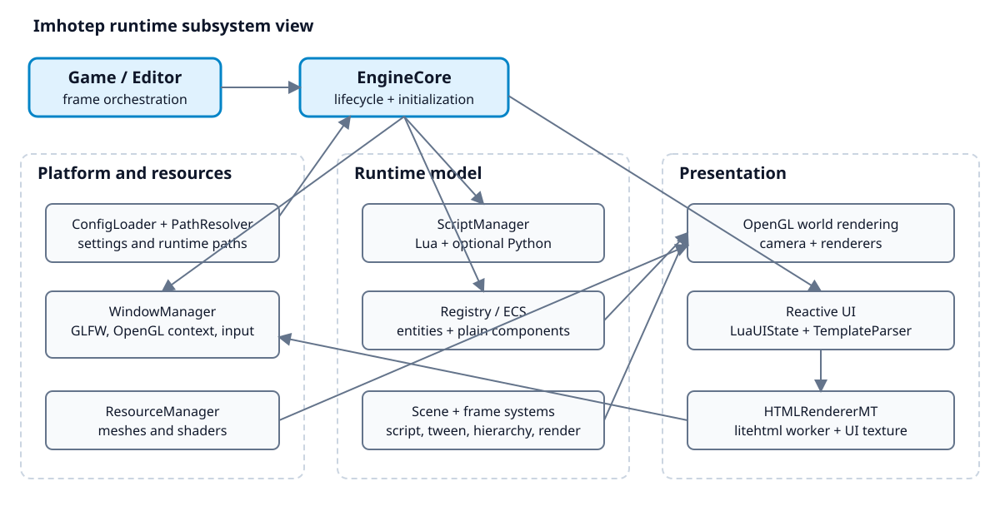
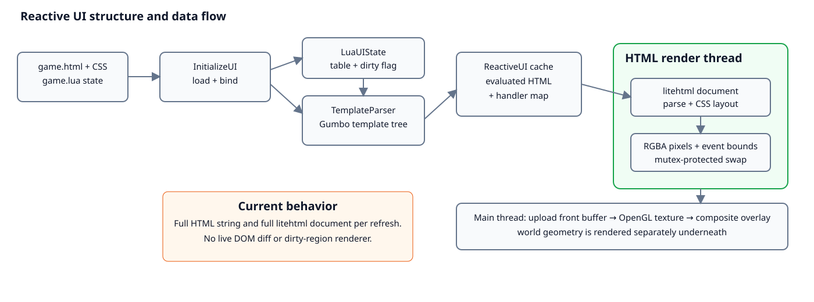
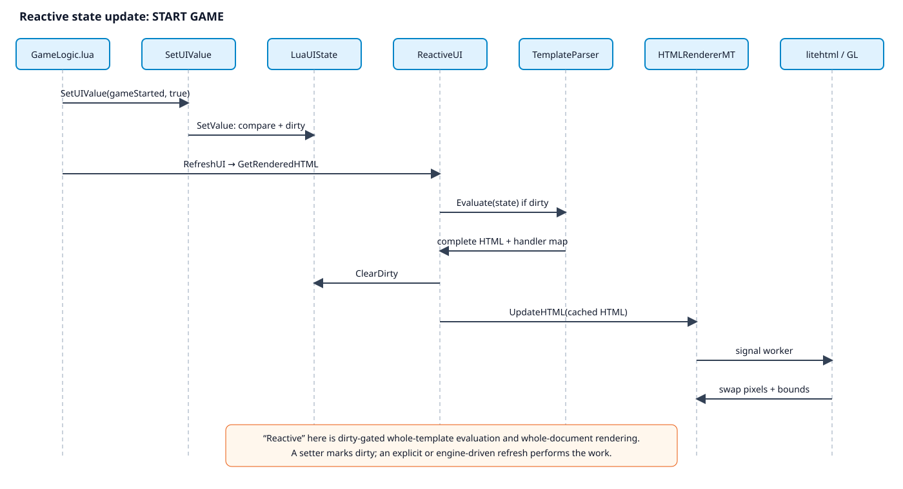
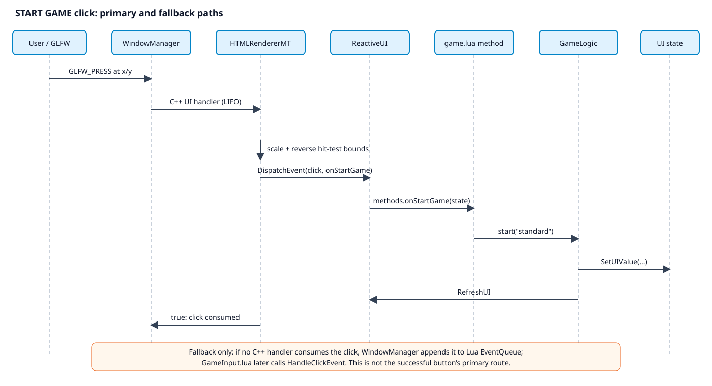

# Engine overview

Imhotep is a C++17/OpenGL engine. `EngineCore` sets up the window, renderer, Lua and optional Python scripting, entity registry, and UI. The game and editor use the same engine services. VaporQube is the included game.

## Engine parts

[Editable diagram](diagrams/engine-subsystems.mmd) · [PNG](diagrams/engine-subsystems.png)

## UI flow

HTML and CSS templates use Lua state. `TemplateParser` evaluates a template into HTML. A worker thread lays out and draws it with litehtml; the main thread uploads the finished pixels to OpenGL.

[Editable diagram](diagrams/ui-data-flow.mmd) · [PNG](diagrams/ui-data-flow.png)

## State updates and clicks

[Editable diagram](diagrams/reactive-update-sequence.mmd) · [PNG](diagrams/reactive-update-sequence.png)

[Editable diagram](diagrams/click-dispatch-sequence.mmd) · [PNG](diagrams/click-dispatch-sequence.png)

`SetUIValue` changes Lua UI state and marks it dirty. `RefreshUI` evaluates the template when needed and queues an HTML render. UI event handlers resolve to methods in the Lua state. See [UI details](UI_SYSTEM.md).

## Scene and frame flow

Scene YAML selects Lua modules and entities. `SceneLoader` checks module roles and dependencies, then initializes modules in dependency order. During a frame, scripts and tweens update, `HierarchySystem` computes world matrices, and render systems draw the scene before the UI is composited. See [runtime contracts](API_CONTRACTS.md).

## Source of truth

The diagrams summarize responsibilities. For exact behavior, use the implementation in `src/`, public interfaces in `include/`, and build options in `CMakeLists.txt`.
